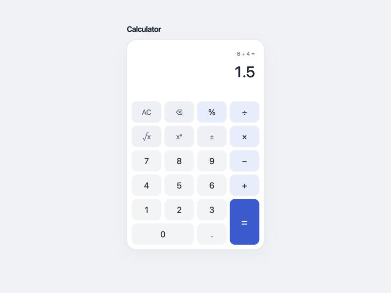
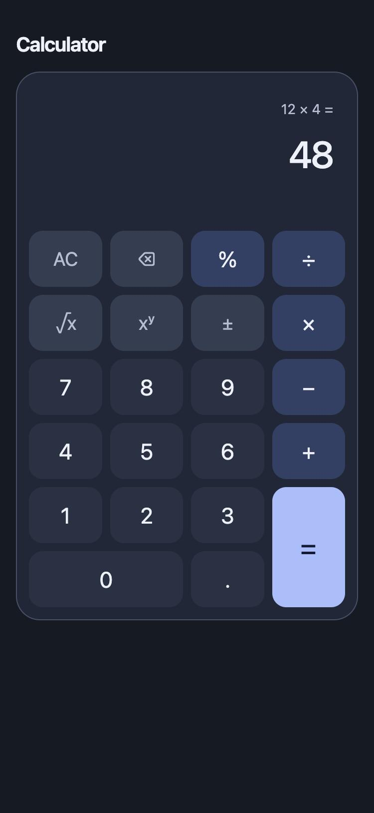

# QA Round 3: 3e16701 (branch `codex/fullstack-calculator`, round-2 fixes)

**Result: PASS (0 blockers, 0 majors, 0 minors).** All four round-2 findings are fixed and verified in the browser with real key presses. The regression pass found nothing new.

Environment: Docker image rebuilt from `3e16701` and run on `:18080`. Browser: the Claude desktop built-in browser at desktop size and 375×812, in light and dark mode. Input was real key presses (`keydown`) and clicks. State was read from the DOM, and API calls were captured and delayed by wrapping `fetch`.

## Automated checks (re-run by QA)

| Check | Result |
|---|---|
| `go vet`, `go test ./...` | pass |
| `npm run lint`, `npm run typecheck` | pass |
| `vitest --coverage` | 88/88 passed. Lines 99.2%, statements 98.0%, branches 97.1% |
| New regression tests against the old code | QA swapped in the `19f31fd` versions of `Calculator.tsx` and `Keypad.tsx`, and 5 tests fail, so the new tests really catch both majors. The files were restored afterwards. |
| `qa/api_contract_test.sh` against the rebuilt container | 40/40 |
| QA-owned files in the commit | `qa/` and `docs/qa/` match the QA versions byte for byte (clean working tree after the commit) |

## Round-2 findings: all fixed

| Round-2 finding | Status | Browser evidence |
|---|---|---|
| [Major] Enter on a focused key runs `=` | Fixed | Focus on `8`, press Enter, and the value is `8` with focus still on `8` and no API call. Enter on Add gives `8 +`. With no key focused, `6 / 4 Enter` still gives `6 ÷ 4 =` / `1.5`, so the shortcut still works. |
| [Major] Focus lost after each calculation | Fixed | Focus on `=` with a 1.5 s delayed response, then press Space. While pending, `=` keeps focus with `aria-disabled="true"`, no `disabled` attribute, opacity 0.55 and a wait cursor, and the calculator has `aria-busy="true"`. After the reply, the display shows `8 + 2 =` / `10`, focus is still on `=`, and `aria-disabled` is gone. |
| ↳ busy edge cases | Pass | While pending, a click on `9` and Enter or Space on a focused `7` are all ignored (value unchanged, 1 API call). Enter on a focused AC aborts the request and resets to `0`, and the late reply is ignored. |
| [Minor] Light-mode digit keys look like plain text | Fixed | Digits now use `#f3f4f6` on the `#fff` card (1.10:1, close to the function keys at 1.14:1), with text contrast of 14.7:1. All 22 keys read as one grid (screenshot below). |
| [Minor] README says browser validation was never done | Fixed, one follow-up | README lines 25 and 190 now link round 2. They still say a screenshot and a browser rerun are pending. This report and the screenshots below close both, so update the README to link them (see "Open"). |

## Regression pass

| # | Observed (expression / value / error) |
|---|---|
| K3 | `5 ×` after `×`, then `5 × 4 =` / `20` |
| K6 (`r`) | `√9 =` / `3` |
| K7 | `15% of 200 =` / `30` |
| K9, K10 | `1 ÷ 0` / `0` / "You can't divide by zero.", then `7` clears the error |
| K24 | `√-4` / `-4` / "Square root needs a number of 0 or more." |
| K25 | `2 ^ 1024` / `1024` / "That result is too large to show." |
| K26 | `0.1 + 0.2 =` / `0.3` |
| Mobile 375px, dark | `12 × 4 =` / `48`. No horizontal or vertical scroll (scrollWidth 375, scrollHeight 812), smallest key 56px |
| Console | only browser-native "Failed to load resource" lines for the deliberate 422s and the stopped-backend test, with no app errors or React warnings |

## Screenshots (from the rebuilt `3e16701` container)

| Desktop, light | Mobile 375px, dark |
|---|---|
|  |  |

## Open
- README: embed `docs/qa/screenshots/desktop-light.jpg` (and optionally `mobile-dark.jpg`). Replace the "screenshot and browser rerun remain pending" sentences at lines 25 and 190 with a link to this report.
- Task 12 (publish to GitHub and check hosted CI) hasn't started and needs the product owner's go-ahead.
